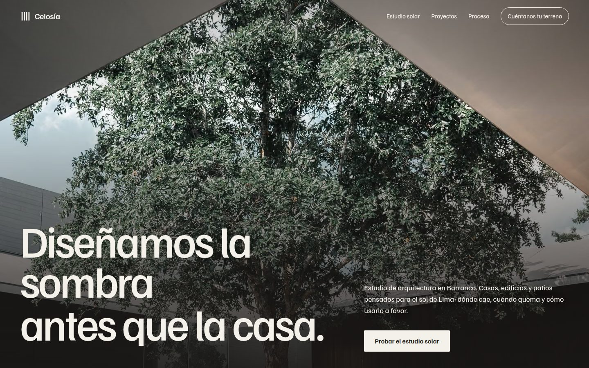
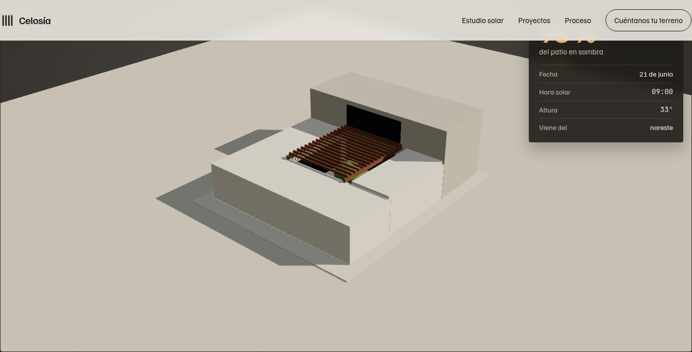
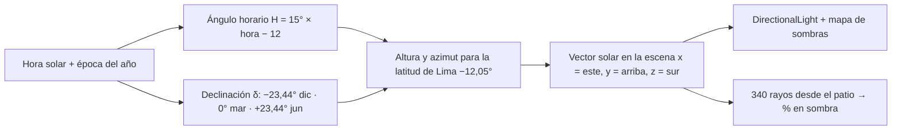
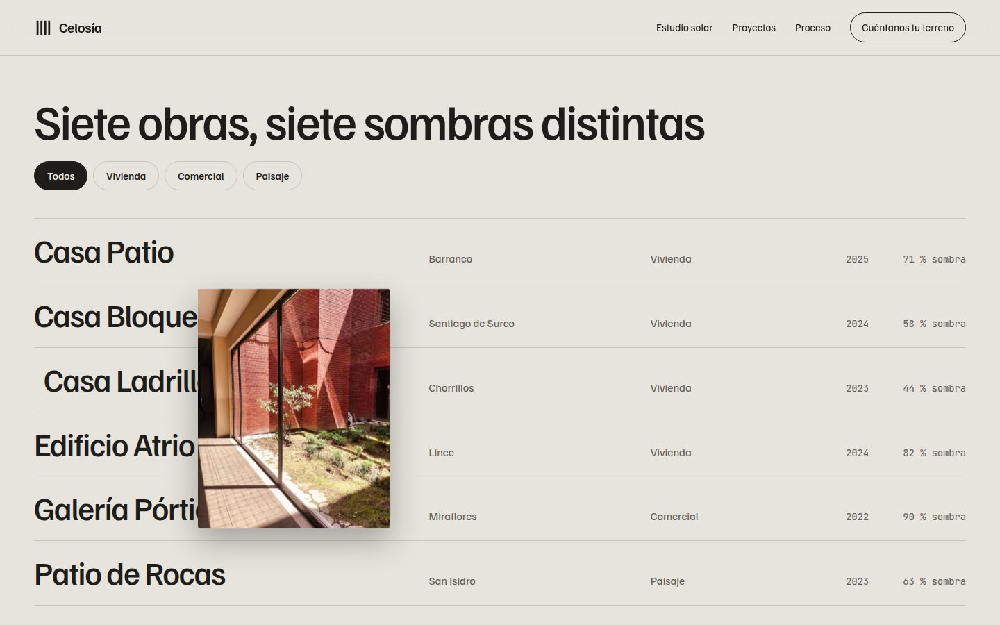
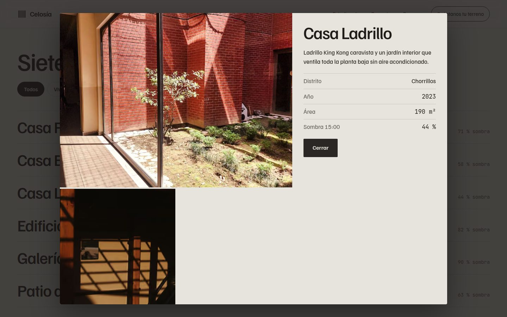

# Celosía — estudio de arquitectura con estudio solar en 3D

**Demo en vivo:** https://landing-architecture-studio-danielyatacoblas-projects.vercel.app



## El problema

Quien va a construir en Lima pregunta por metros cuadrados y acabados, pero lo que decide si una casa se vive bien es **dónde cae el sol**: el patio que quema a las 3 de la tarde en verano, la sala que nunca recibe luz en invierno. Los estudios lo explican con planos que el cliente no sabe leer.

Celosía es un estudio ficticio que convierte eso en algo que se toca: **una maqueta 3D donde mueves el sol de Lima y ves la sombra caer**, con el porcentaje del patio en sombra calculado en tiempo real.

## Qué hace

| Sección | Qué resuelve | Técnica |
|---|---|---|
| Hero | Presentar la idea del estudio | Persianas que se abren (8 listones con `scaleX` escalonado), titular por líneas, parallax |
| Estudio solar | Ver la sombra antes de construir | **Three.js**: maqueta con volúmenes, celosía de 16 listones y árbol; sombras PCF suaves; `OrbitControls`; renderizado solo cuando algo cambia; Three.js se descarga solo cuando la sección se acerca |
| % del patio en sombra | Medir, no adivinar | 340 rayos (`Raycaster`) desde una grilla del piso del patio hacia el sol |
| Proyectos | Ver obras | Índice editorial con vista previa que sigue al cursor (`gsap.quickTo`), filtros y ficha en `<dialog>` |
| Celosía | Contar el criterio del estudio | Sombra rayada que se desliza con el scroll |
| Proceso | Explicar tiempos | Línea que se dibuja con el scroll y fotos que se revelan con `clip-path` |
| Contacto | Captar el lead | Formulario con validación de área, tipo de proyecto y presupuesto; lead a Supabase |



## Cómo se calcula el sol



La matemática vive en [`lib/sun.ts`](lib/sun.ts) y tiene pruebas en [`tests/sun.test.ts`](tests/sun.test.ts) con valores verificables a mano: al mediodía del 21 de diciembre el sol de Lima pasa por el **sur** a 78,6°, y el 21 de junio por el **norte** a 54,5°.

```bash
npm test
# ✔ mediodía de equinoccio: el sol está al norte a 78° (90 − 12)
# ✔ mediodía de verano en Lima: el sol pasa por el sur, casi cenital
# ✔ mediodía de invierno: sol bajo y al norte
# ✔ en la mañana el sol está al este y en la tarde al oeste
# ✔ el vector solar es unitario y apunta hacia arriba de día
```



## Stack

- **Next.js 16** + **React 19** + **TypeScript** estricto, prerender estático
- **Three.js** con import dinámico: no pesa en la carga inicial
- **GSAP 3 + ScrollTrigger** y **Lenis**
- Familjen Grotesk y JetBrains Mono (solo para medidas y datos) con `next/font`
- `node:test` para la lógica solar; **Supabase** opcional para leads; **Vercel**

## Diseño

- Hecho con las skills de [Impeccable](https://impeccable.style/) y [Emil Kowalski](https://github.com/emilkowalski/skills).
- Paleta de concreto claro con secciones en "sombra" oscura y un ocre de sol como único acento.
- Sin WebGL, la sección lo dice en vez de quedar vacía; con `prefers-reduced-motion` se apagan Lenis y las animaciones.
- En pantallas táctiles el índice de proyectos muestra la foto en cada fila en lugar de la vista previa flotante.



## Correr local

```bash
npm install
npm run dev
npm test
npm run build
```

## Créditos

- Fotografía: [Pexels](https://www.pexels.com).
- Celosía es ficticio: proyectos, áreas, porcentajes y direcciones son de demostración.

---

Diseñado y desarrollado por [Daniel Yataco](https://github.com/danielyatacoblas).
